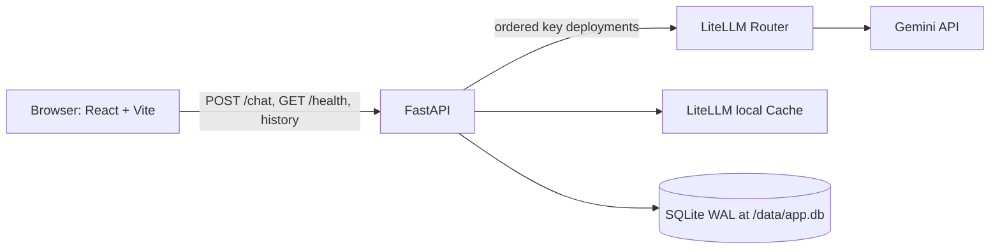

# Relay AI — LYFTR AI Full-Stack Assignment

Relay AI is a React/Vite client with a FastAPI service, LiteLLM Gemini gateway, and SQLite conversation storage.

## 1. Live URLs

The public UI is available. Backend provisioning and live acceptance are pending.

- Frontend: https://relay-ai-shashwat-tripathi.gauzyadage64.chatgpt.site
- Backend: **pending deployment**
- Public GitHub repository: https://github.com/pragya-4/relay-ai
- Demo video: **record after live acceptance checks**

## 2. Run locally: with Docker and without

### Docker

Prerequisites: Docker Desktop with Compose, GNU Make (or use the equivalent Compose commands), and two valid Gemini API keys.

1. Copy `.env.example` to `.env`.
2. Put two comma-separated keys in `LLM_API_KEYS`. Keep `.env` local and private. `LLM_MODEL` defaults to `gemini/gemini-3.5-flash-lite`.
3. Run `make up` (or `docker compose up --build -d`). The UI listens on `http://localhost:3000`; the API listens on `http://localhost:8000`.
4. Run `make down` to stop the services. This does not delete the named database volume.

Do not use `docker compose down -v` unless you intend to permanently remove local conversation data.

### Without Docker (PowerShell)

Use Python 3.12+, Node 22+, and the same local `.env` values.

```powershell
cd backend
py -3.12 -m venv .venv
.\.venv\Scripts\Activate.ps1
pip install -r requirements-dev.txt
$env:DATABASE_URL = 'sqlite:///./app.db'
python -m uvicorn main:app --env-file ../.env --port 8000
```

In a second PowerShell window:

```powershell
cd frontend
npm ci
npm run dev -- --host 127.0.0.1 --port 3000
```

On Linux/macOS, create a venv with `python3 -m venv .venv`, activate it with `source .venv/bin/activate`, install `backend/requirements-dev.txt`, then run Uvicorn and Vite from separate terminals. From backend/ run `DATABASE_URL=sqlite:///./app.db python -m uvicorn main:app --env-file ../.env --port 8000`.

## 3. Design decisions: key fallback, caching, SQLite session storage

- **Key fallback:** Each credential has its own LiteLLM Router alias. The gateway calls these aliases in environment order, once each, until a provider returns a nonempty completion with usage. It records the number of earlier failures and returns the successful alias. The API returns only the alias. One process/worker is the supported concurrency model because the local cache and per-session locks are process-local.
- **Caching:** The application uses LiteLLM's built-in local `Cache`. The cache identity uses the configured model and complete messages array (system prompt, prior turns, and new message); it excludes session ID and API key. Cache hits return stored provider token usage, `key_id: null`, and `fallback_attempts: 0`. A simulated request bypasses cache reads so a previous result cannot hide the failure demonstration.
- **SQLite:** SQLite WAL mode, a busy timeout, parameterized statements, per-session striped locks, chronological message IDs, and an atomic user/assistant transaction. Provider calls happen before the write transaction. Successful messages persist under the named `relay_data` Docker volume mounted at `/data`; failed calls do not create a session or partial history.



### Configuration reference

| Variable | Purpose |
|---|---|
| `LLM_API_KEYS` | Two or more comma-separated Gemini API keys. Never commit them. |
| `LLM_MODEL` | LiteLLM model ID; default `gemini/gemini-3.5-flash-lite`. |
| `DATABASE_URL` | SQLite URL; Docker uses `sqlite:////data/app.db`. |
| `ALLOWED_ORIGINS` | Comma-separated exact frontend origins. |
| `ENABLE_FAILURE_SIMULATION` | Enables the per-request `X-Simulate-Failure` test hook. |
| `VITE_API_URL` | Backend base URL embedded in the frontend build. |
| `PORT` | Backend listen port; deployment platforms may set it dynamically. |

## 4. Verification: how to see failover, cache hits and per-message token usage

The backend suite includes FastAPI/SQLite contract tests and HTTP-level LiteLLM integration tests using a local Gemini fixture. See VERIFICATION.md for results.

```powershell
cd backend
pip install -r requirements-dev.txt
python -m pytest -q
```

Frontend build and browser checks:

```powershell
cd frontend
npm ci
npm run build
npx playwright install chromium
npm run test:e2e
```

The browser tests use Chromium (or set CHROME_PATH to an installed browser) and stub API replies to test UI behavior. They are not live-provider acceptance tests.

For a running local or deployed backend:

```powershell
python scripts/check_models.py
python scripts/verify_live.py https://YOUR-BACKEND-URL
```

The first script privately checks each key’s model catalog without generating tokens. The second script makes real generation requests. Use confirmed free-tier projects or obtain a spending decision first. It uses unique prompts to check live inference, a cache hit, `key_1=429`, `key_1=500`, independent generation with each key, `*=429`, history persistence, and input rejection. The test hook exercises real inference through surviving keys; the simulated failure itself is not a real provider outage. Run it only after configuring fresh valid keys and the correct production CORS origin.

For connected browser acceptance, run `node frontend/tests/connected.mjs https://YOUR-FRONTEND-URL` with Chromium installed. This sends real requests through the public UI.

In the UI, send the same first message in two new conversations to see `LIVE_INFERENCE` then `LLM_CACHE`. Use the Resilience Lab to show key 1 rate-limit/server failure, all-key failure, and recovery. Every assistant reply includes its own source, model, latency, input-token, and output-token fields.

## 5. Setup Used: your editor and AI tools

- AI assistant: OpenAI Codex desktop.
- Shell: Windows PowerShell.
- Runtime and checks: Python, FastAPI, pytest, Node.js, Vite, Playwright, Docker Compose, and the installed Chrome browser.
- This revision was edited and tested in ChatGPT Work Mode with Codex on Linux.

## 6. Bonus features (if any): what you added beyond the requirements and why

Editable system prompt, fresh-session button, backend health indicator, per-session telemetry, retryable error state, responsive layout, and Resilience Lab controls for deterministic failover demonstrations.

## API examples

```powershell
Invoke-RestMethod http://localhost:8000/health
$body = @{ session_id = 'demo-1'; message = 'What is the capital of France?' } | ConvertTo-Json
Invoke-RestMethod -Method Post -Uri http://localhost:8000/chat -ContentType 'application/json' -Body $body
Invoke-RestMethod http://localhost:8000/sessions/demo-1/messages
```

A request error returns JSON with a `detail` field. Unknown session history returns 404. A failed inference does not persist a partial message pair.

## Deployment and limitations

Use a persistent-volume-compatible host for the backend and mount a volume at `/data`; configure `DATABASE_URL=sqlite:////data/app.db`, at least two provider keys, `ENABLE_FAILURE_SIMULATION=true`, and `ALLOWED_ORIGINS` to the exact public frontend origin. Build the frontend with `VITE_API_URL` set to the public HTTPS API origin. Verify the URLs and run `scripts/verify_live.py` before publishing them here.

The local LiteLLM cache and striped locks are in-memory/process-local. Run one backend worker and one replica for the demonstrated ordering and cache guarantees. Public evaluation endpoints are unauthenticated by assignment design; use low-quota demo credentials, do not enter private data, and disable failure simulation after evaluation. CORS alone is not authentication.
